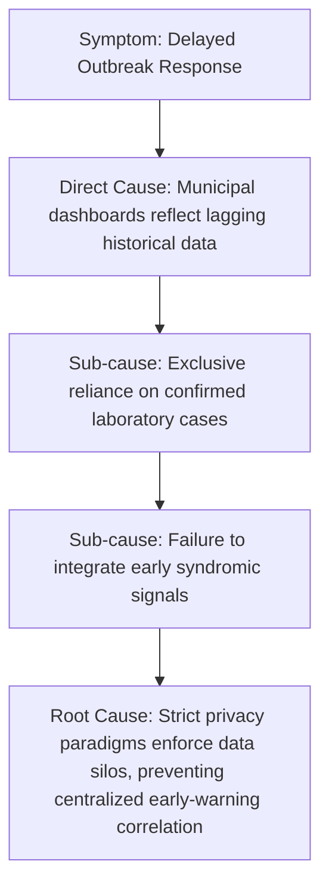
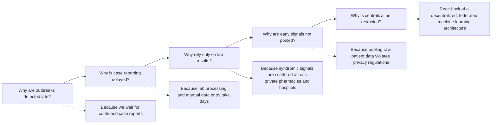
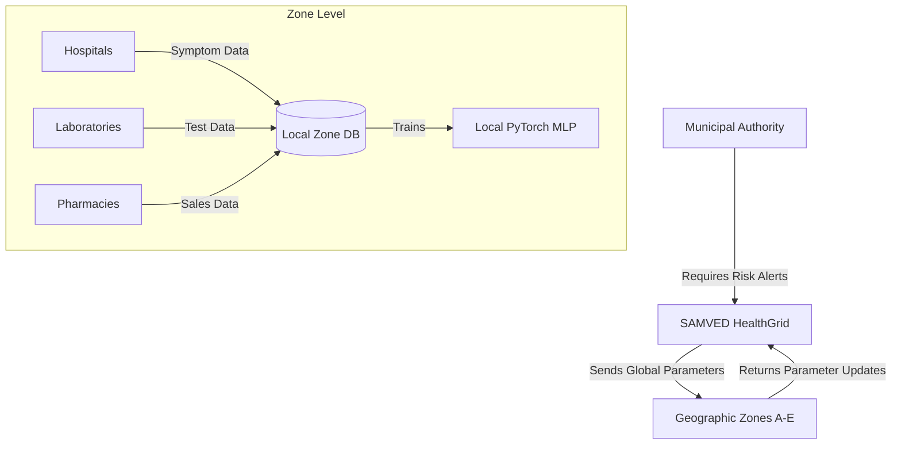
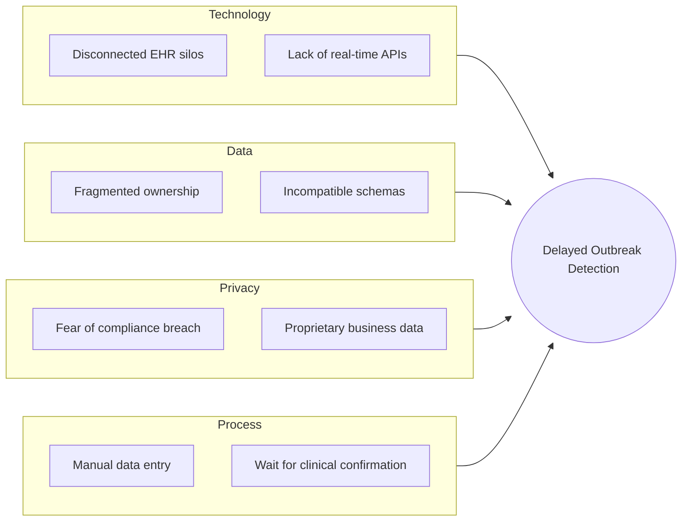

# CHAPTER 2: PROBLEM IDENTIFICATION AND ANALYSIS

## 2.1 Problem Identification
The core problem was identified during the initial phases of the SMC Hackathon 2025–26, where the Solapur Municipal Corporation (SMC) presented a direct challenge regarding a "Smart Public Health Management System." During the hackathon’s prototype round, it became evident that municipal authorities face severe information lag when attempting to track localized disease spread across disconnected wards and independent hospitals. The team successfully built an initial prototype to demonstrate basic data collection, but recognized that a much deeper architectural solution was required to handle the complexities of data privacy and early prediction. Consequently, the team selected this challenge and expanded it into a comprehensive final-year academic project.

## 2.2 Problem Selection
The selection of this problem was driven by multiple intersecting factors:
1. **Social Relevance**: Epidemics impose a catastrophic burden on society. Shifting the detection timeline forward by even a few days enables proactive containment, saving lives and reducing economic strain.
2. **Technical Relevance**: The problem demands the integration of cutting-edge technologies—specifically, distributed machine learning (Federated Learning) and spatial data processing (PostGIS/Leaflet)—which are highly relevant in the modern software industry.
3. **Privacy Challenge**: Addressing how to perform machine learning on data that cannot legally or ethically be centralized represents a premier challenge in contemporary data science.
4. **Research Value**: The project provides a rare opportunity to study the behavior of the FedAvg algorithm over non-IID geographic syndromic data distributions.
5. **Implementation Feasibility**: While real, linked medical data is inaccessible, utilizing a rigorously designed stochastic SEIRS generator makes the evaluation of the architecture academically feasible.
6. **Municipal Relevance**: The outputs of this project—geographic risk maps and alerts—are explicitly aligned with the administrative needs of city officials, ensuring the project solves a tangible, real-world governance problem.

## 2.3 Problem Definition
**Relevance**: Traditional outbreak surveillance is critically delayed and centralized, exposing public health to delayed reactions and data privacy risks.

**Objectives**: The primary objective is to design and implement a simulation-based proof of concept that uses data-local geographic Federated Learning for multi-source syndromic surveillance, capable of predicting outbreak onset within a seven-day future horizon.

**Target Users**: Municipal public health officers monitoring geographic zones, and system administrators orchestrating the federated nodes.

**Constraints**: The most critical constraint is that raw zone-level records must remain local during Federated Learning; only model parameter updates can be aggregated. Additionally, because real linked medical data is restricted, the system is constrained to utilizing synthetic SEIRS-generated timelines. 

**Assumptions**: It is assumed that the non-IID synthetic data accurately mirrors the structural complexity of geographic reporting variance. It is also assumed that participating zones possess the minimal computational capacity required to execute a lightweight PyTorch MLP locally.

**Expected Outputs**: The system is expected to output a trained global predictive model, a spatial dashboard rendering zone-level risk heatmaps, and a rigorous empirical evaluation quantifying the Event Detection Rate against the False Warning Rate.

## 2.4 Problem Analysis

### 2.4.1 Root Cause Analysis
To deeply understand why outbreak detection is delayed, a Root Cause Analysis was performed. The primary symptom is "Delayed Outbreak Response." The direct cause is that municipal dashboards only reflect historical data. Digging deeper, this occurs because authorities rely exclusively on confirmed laboratory cases. The root cause is a fundamental lack of integration with early syndromic indicators (like pharmacy sales) and a restrictive privacy paradigm that forces institutions to silo their early-warning data rather than compute on it collaboratively.

*(Figure 2.1: Root Cause Analysis)*

### 2.4.2 Why-Why Analysis
The Why-Why (5 Whys) technique was applied to trace the path from the observed failure to the underlying architectural gap.

*(Figure 2.2: Why-Why Analysis)*

### 2.4.3 Stakeholder Analysis
A stakeholder interaction analysis maps how entities interact within the surveillance ecosystem, highlighting the friction between the need for data and the mandate for privacy.

*(Figure 2.3: Stakeholder Interaction Diagram)*

### 2.4.4 Fishbone Analysis
A Fishbone (Ishikawa) diagram categorizes the diverse causes contributing to delayed outbreak detection. Because Mermaid does not support a native fishbone layout, the diagram is represented as a structured left-to-right flowchart categorized by origin.

*(Figure 2.4: Fishbone-style Cause Analysis)*

## 2.5 Existing Process
In the existing conventional disease surveillance workflow, the process begins when an infected patient develops sufficiently severe symptoms to visit a hospital. A clinician evaluates the patient and orders a laboratory test. The sample is transported, processed, and confirmed days later. Once positive, the laboratory or hospital administrators manually compile these cases into a weekly spreadsheet or portal. Municipal health officers then download this data, aggregate it centrally, visually inspect the counts, and declare an outbreak intervention if the numbers definitively surge past historical baselines.

## 2.6 Limitations of Existing System
The traditional system presents severe, compounding limitations:
1. **Reporting Delay**: The multi-step process from symptom onset to municipal reporting often takes 7 to 14 days, entirely negating the opportunity for early containment.
2. **Fragmented Data**: Essential early signals, such as sudden spikes in fever medicine purchases at pharmacies or an influx of mild symptoms at outpatient clinics, are ignored because they exist in disconnected commercial databases.
3. **Limited Geographic Visibility**: Centralized reports often obscure the exact zone or neighborhood where an outbreak is originating, hampering targeted interventions.
4. **Reactive Decision-Making**: Administrators must wait for a massive surge to be visible to the naked eye before reacting, rather than relying on predictive analytics.
5. **Privacy Concerns**: When authorities attempt to modernize by requesting granular data, institutions resist due to severe privacy, legal, and competitive risks associated with centralizing patient records.
6. **Absence of Reproducible Early-Warning Evaluation**: Current systems lack a mathematically rigorous, simulation-backed method to optimize the trade-off between detecting outbreaks early and minimizing false operational alarms.

### Chapter Summary
This chapter traced the project's origins to the SMC Hackathon and systematically analyzed the root causes of surveillance failures using structured Why-Why, Stakeholder, and Fishbone analyses. It established that traditional systems are critically crippled by reporting delays, privacy-enforced data silos, and a lack of multi-source syndromic correlation. The problem analysis unequivocally justifies the necessity for a data-local, federated early-warning architecture.
