# CHAPTER 5: SYSTEM DESIGN

## 5.1 System Architecture
The SAMVED HealthGrid architecture is intrinsically decentralized, designed specifically to address the privacy and scalability bottlenecks of traditional centralized surveillance. The system enforces strict data locality by operating across distinct layers:

1. **Data-Source Layer**: The generation layer where hospital, laboratory, pharmacy, and weather observables are instantiated.
2. **Zone-Client Layer**: The five non-IID geographic zones (Zones A to E) act as the primary compute nodes. Raw data remains perpetually isolated within this layer.
3. **Local Preprocessing and Training**: Each zone extracts the 12-dimensional feature vector, handles missing values, and trains a PyTorch Multi-Layer Perceptron (MLP) over local epochs using `BCEWithLogitsLoss`.
4. **Flower Communication**: The clients establish gRPC connections to the central Flower server to transmit the mathematical parameter updates (gradients/weights) of the neural network.
5. **FedAvg Server**: The Flower server executes the Federated Averaging algorithm, creating a new global model without ever inspecting the raw zone data, and broadcasts the updated model back to the clients.
6. **Global-Model Storage**: Post-training, the final `.pth` checkpoint is saved to disk for inference.
7. **FastAPI Inference**: A dedicated Python microservice exposes an endpoint that loads the frozen global model, standardizes incoming JSON payloads, and returns a Sigmoid probability.
8. **Express Backend**: A Node.js API acts as a gateway, intercepting predictions and executing geospatial queries.
9. **PostGIS Storage**: The PostgreSQL database stores the predictions alongside PostGIS `POINT` geometries corresponding to zone centroids.
10. **React & Leaflet GIS Dashboard**: The frontend queries the backend and visually renders color-coded polygons based on the risk category.
11. **Alert Flow**: If a zone crosses the critical risk threshold, the dashboard triggers a visual "High Risk" alert for immediate municipal intervention.

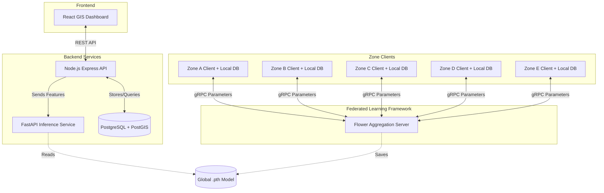
*(Figure 5.1: Overall System Architecture)*

## 5.2 Module-Level Design

Table 5.1: Module-Level Design
| Module | Input | Processing | Output |
| :--- | :--- | :--- | :--- |
| **SEIRS Generator** | Seed, Population, Days | Applies stochastic ODE transitions and observational delay matrices. | 5 Zone CSV files |
| **Zone FL Client** | Zone CSV, Global Weights | Partitions chronologically, scales features, executes PyTorch SGD. | Updated Local Weights |
| **Flower Server** | Local Weights from 5 Zones | Averages weights based on sample proportion (FedAvg). | Global Weights (.pth) |
| **FastAPI Inference** | 12-Feature JSON | Applies Standard Scaler, executes MLP forward pass, applies Sigmoid. | Outbreak Probability |
| **Node.js Gateway** | Client Requests | Validates payloads, executes PostGIS intersection/insertion queries. | JSON / GeoJSON |
| **React Dashboard** | GeoJSON Risk Data | Maps probabilities to colors, overlays on Leaflet maps. | Visual GIS Heatmap |

## 5.3 System Workflow

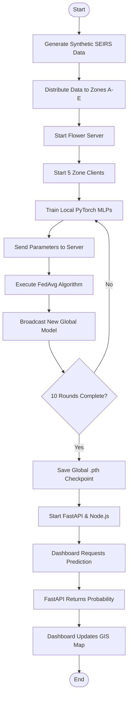
*(Figure 5.2: End-to-End System Workflow)*

## 5.4 UML Diagrams

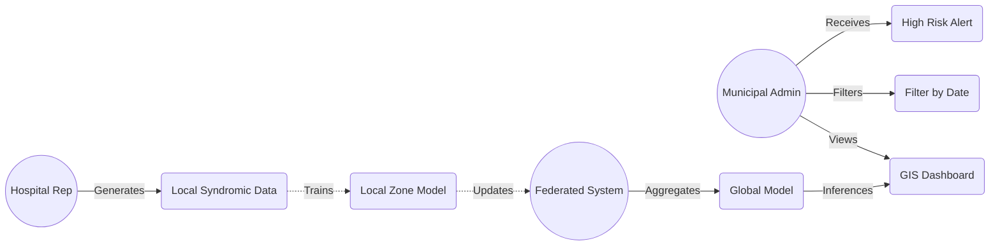
*(Figure 5.3: Use Case Diagram)*

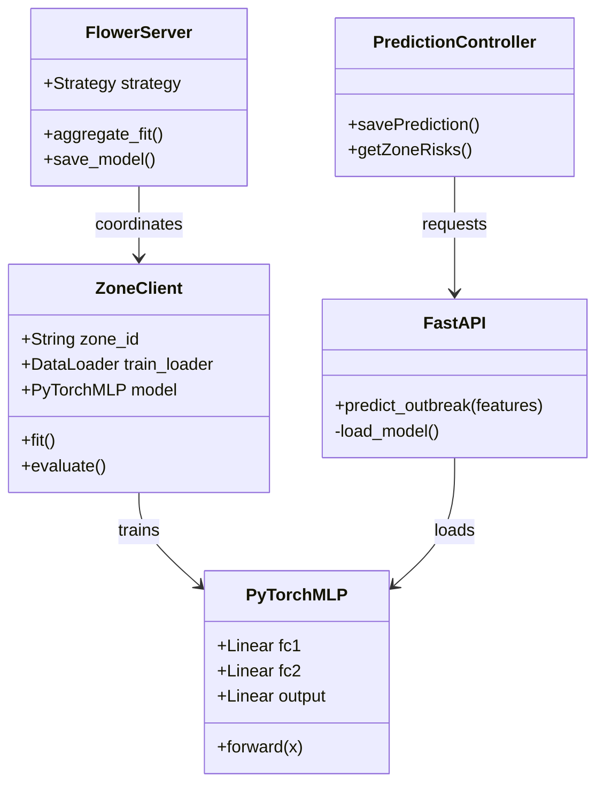
*(Figure 5.4: Class Diagram)*

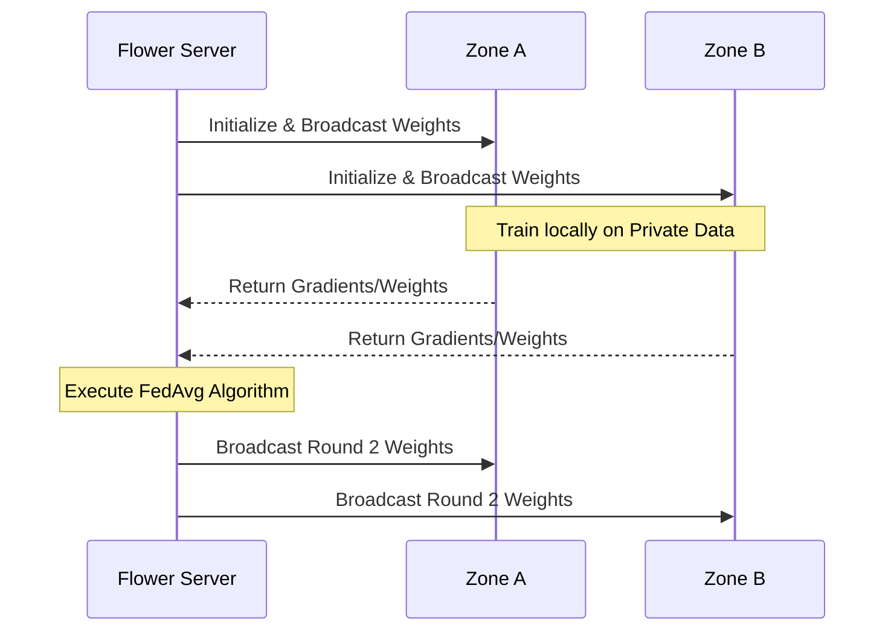
*(Figure 5.5: Federated Training Sequence Diagram)*

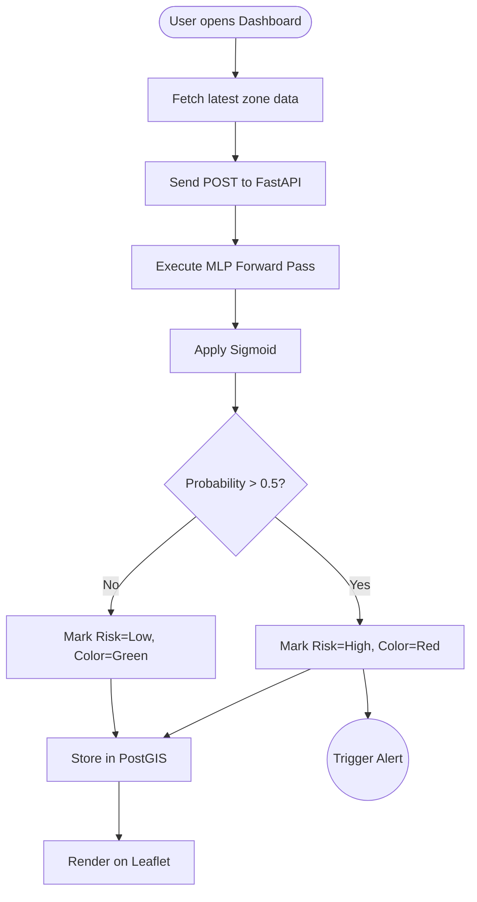
*(Figure 5.6: Prediction and Alert Activity Diagram)*

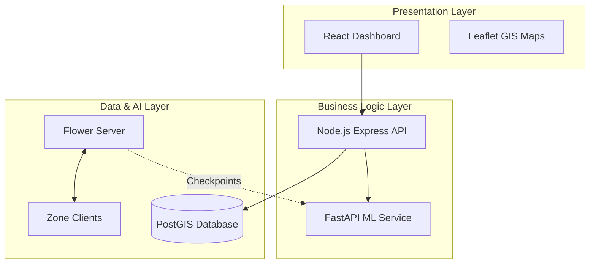
*(Figure 5.7: Component Diagram)*

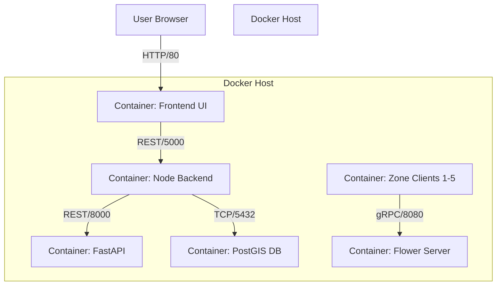
*(Figure 5.8: Deployment Diagram)*

## 5.5 Data Flow Diagrams

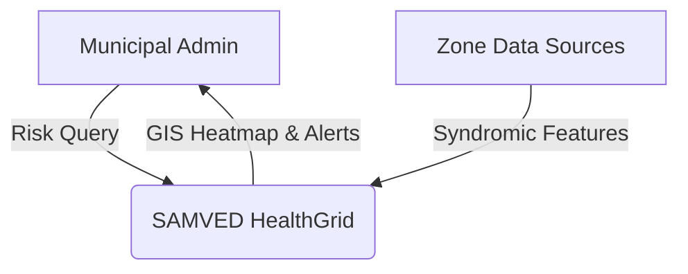
*(Figure 5.9: Context-Level DFD)*

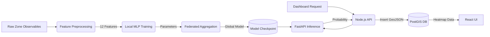
*(Figure 5.10: Level 1 DFD)*

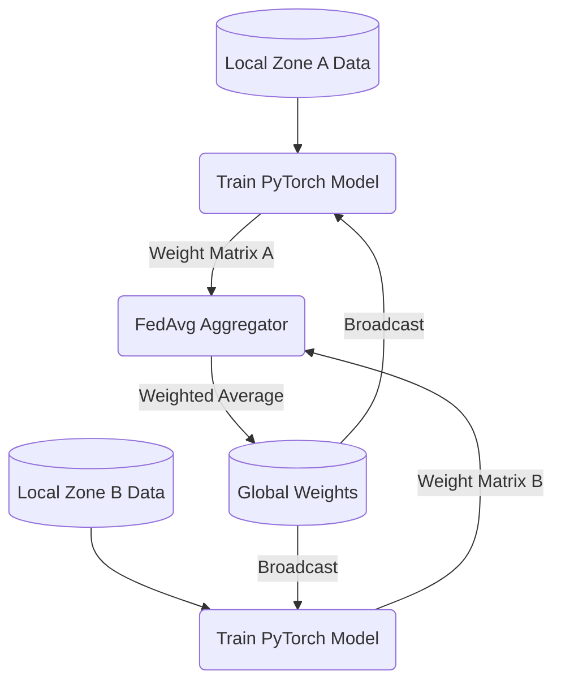
*(Figure 5.11: Federated Training Level 2 DFD)*

## 5.6 Database Design
The system utilizes PostgreSQL heavily extended with PostGIS to execute spatial queries mapping probabilities to precise geographic areas. The design employs a standard relational structure.

**Key Entities:**
- **predictions**: Stores the primary AI inference results including the probability, computed risk level, and PostGIS geometry.
- **hospital_stats / laboratory_stats / pharmacy_stats**: Store the raw generated observables before they are aggregated into the 12-feature tensor.
- **weather_data**: Stores regional meteorological signals.

**PostGIS Geometry:** The `predictions` table contains a `geom` column using `geometry(Point, 4326)`. This allows the React dashboard to request risk levels by spatial bounding box rather than just text identifiers.

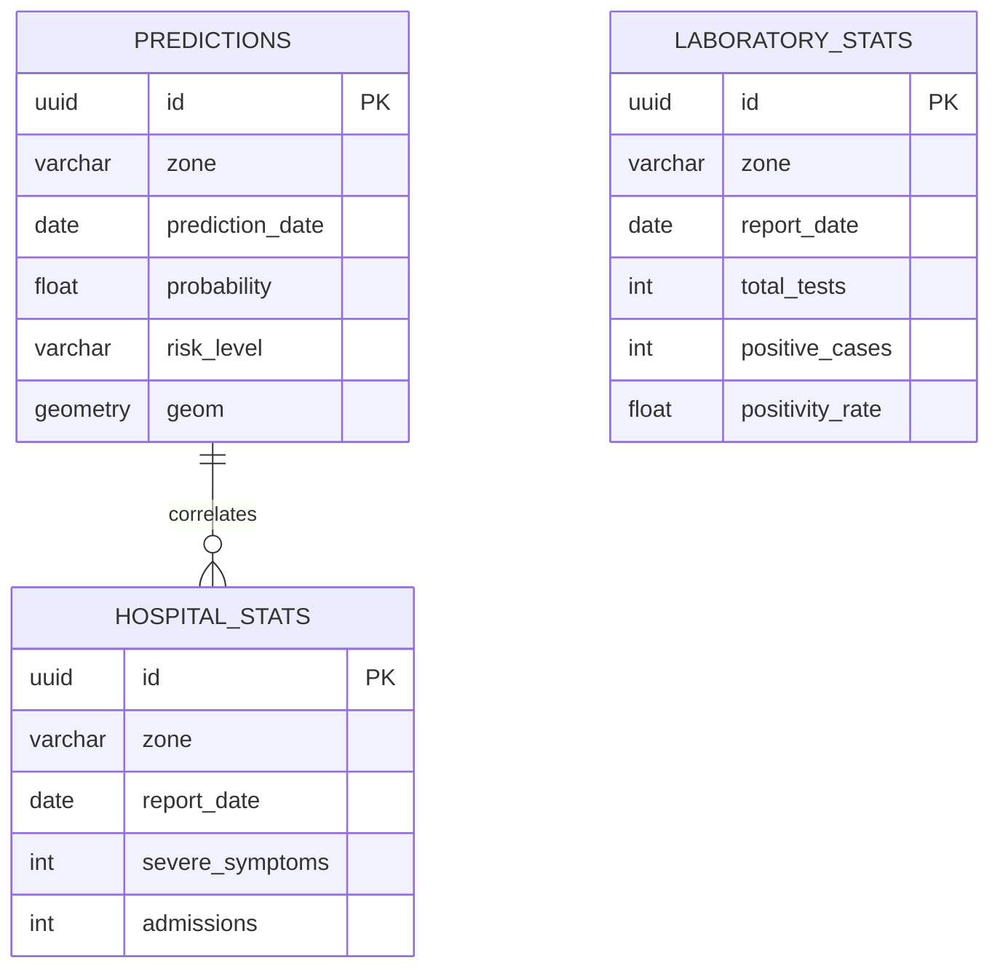
*(Figure 5.12: Entity Relationship Diagram)*

Table 5.2: Database Data Dictionary (Excerpt - predictions table)
| Field | Data Type | Key | Description |
| :--- | :--- | :--- | :--- |
| `id` | UUID | Primary Key | Unique prediction record identifier. |
| `zone` | VARCHAR(50) | Indexed | The municipal zone identifier (e.g., 'Zone A'). |
| `prediction_date` | DATE | Indexed | The chronological date of the prediction. |
| `probability` | FLOAT | None | The Sigmoid output (0.0 to 1.0) from the PyTorch MLP. |
| `risk_level` | VARCHAR(20) | None | Mapped category ('Low', 'Medium', 'High'). |
| `geom` | GEOMETRY(Point, 4326) | Spatial Index | PostGIS spatial coordinates for Leaflet rendering. |

### Chapter Summary
This chapter laid out the foundational architecture of the SAMVED HealthGrid, demonstrating how decentralized computing interfaces with modern web standards. Detailed UML models (Use Case, Sequence, Class, Component) explicitly documented the data separation enforced between the Zone Clients and the Flower Server. Data Flow Diagrams mapped the transformation of raw SEIRS data into geospatial heatmaps, and the PostGIS schema solidified the system's ability to render predictive alerts geographically.
