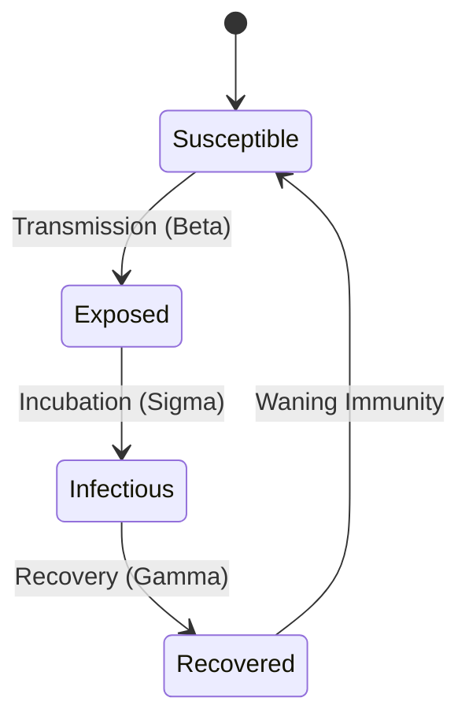
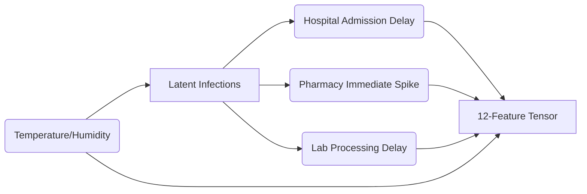
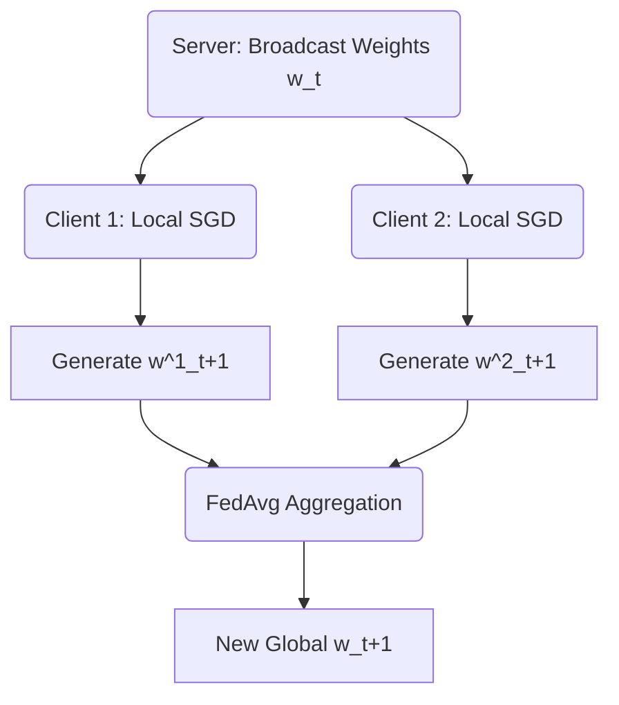
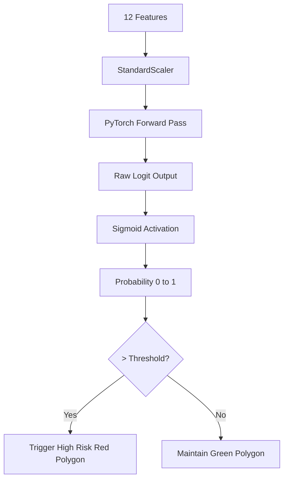

# CHAPTER 6: DEVELOPMENT AND IMPLEMENTATION

## 6.1 Development Environment
The SAMVED HealthGrid was developed on a Windows 11 host operating system utilizing Visual Studio Code. Because the project spans deep learning, backend APIs, and frontend interfaces, environment parity was critical. This was achieved by strictly containerizing the execution runtime using Docker Desktop (Docker Engine 24+).

## 6.2 Technologies and Tools

Table 6.1: Technologies and Their Purpose
| Technology | Category | Purpose and Justification |
| :--- | :--- | :--- |
| **Python 3.10** | Core Language | Selected for its universal support for modern machine learning frameworks. |
| **PyTorch** | Deep Learning | Provides dynamic computational graphs and extensive customization for the MLP. |
| **Flower (flwr)** | Federated Learning | Selected for its robust gRPC protocols and out-of-the-box FedAvg strategies. |
| **FastAPI** | Inference Service | Extremely fast Python web framework ideal for serving ML model checkpoints. |
| **Node.js & Express** | Backend Gateway | Non-blocking I/O ensures high throughput for dashboard requests. |
| **PostgreSQL & PostGIS** | Spatial Database | The only open-source relational database with enterprise-grade GIS extensions. |
| **React & Leaflet.js** | Frontend UI | React provides component-based state, while Leaflet renders the geographic maps. |
| **Docker Compose** | Orchestration | Automates the synchronized startup of 10+ distinct microservices. |

## 6.3 Implementation of Individual Modules

### 6.3.1 SEIRS Generator and Observable Generation
Because real hospital data cannot be legally shared, the project relies on a highly sophisticated `generate_synthetic_epidemic_v2_final.py` script. The implementation divides the population into Susceptible, Exposed, Infectious, and Recovered states. The business logic executes stochastic transitions daily. Rather than a flat curve, the generator forces non-IID conditions by giving Zone A dense populations with high hospital access, while giving Zone E rural characteristics with delayed testing.

### 6.3.2 Local MLP and Flower Client
The Zone Client is implemented via the `flower-clients/client.py` script. The client extends Flower’s `NumPyClient`. During the `fit()` method, the client receives global weights, injects them into a local PyTorch MLP instance, trains the network over 1 local epoch using an Adam optimizer, and returns the updated parameters. 

### 6.3.3 FastAPI Service
Implemented in `backend/app.py`, this service loads the `global_model_final.pth` checkpoint upon startup. It exposes a `/predict` endpoint that applies the exact same `StandardScaler` fitted during the training phase to ensure identical feature normalization, preventing data distribution shifts during inference.

### 6.3.4 React and Leaflet Dashboard
The dashboard uses `react-leaflet` to draw GeoJSON polygons representing the five zones over an open-source tile layer. The application polls the Node.js API periodically, mapping probability scores > 0.5 to a red "High Risk" visual alert, alerting the administrator of an impending outbreak onset.

## 6.4 Algorithms and Business Logic

### 6.4.1 Target Definition and Feature Construction
A critical piece of business logic is defining what an "outbreak" actually is. The target rule states:
- **Outbreak Onset (Target = 1)**: True if the latent infectious incidence crosses a sustained threshold of 40 cases within the chronological 7-day future horizon.
- **Normal (Target = 0)**: Otherwise.

The 12 features generated include: `hosp_symptom_rolling`, `hosp_admissions_rolling`, `lab_positivity_rate`, `pharm_fever_rolling`, `pharm_cough_rolling`, `weather_temp`, `weather_humidity`, etc. Pharmacy signals deliberately "lead" hospital admissions by 2-4 days, mathematically rewarding the neural network for learning the pharmacy correlation.

### 6.4.2 PyTorch Forward Pass and Loss
The architecture is a Multi-Layer Perceptron (12 → 64 → 32 → 1).
The forward pass is defined as:
`Z = W2 * ReLU(W1 * X + b1) + b2`
The network outputs a raw logit. The loss function utilized is `BCEWithLogitsLoss`, which mathematically combines the Sigmoid activation and Binary Cross Entropy into a single, numerically stable class. During FastAPI inference, the explicit Sigmoid function `P(y=1|X) = 1 / (1 + e^-Z)` is applied to retrieve the probability.

### 6.4.3 Federated Averaging (FedAvg) Algorithm
The central Flower server aggregates the weights using FedAvg. The business logic is implemented as follows:
Let `w_t` be the global weights at round `t`. The server broadcasts `w_t` to `K` zones.
Each zone `k` trains on its local data `n_k` to produce new weights `w_{t+1}^k`.
The server aggregates them proportionally:
$$ w_{t+1} = \sum_{k=1}^{K} \frac{n_k}{N} w_{t+1}^k $$
Where `N` is the total number of samples across all participating zones.

*(Figure 6.1: SEIRS State-Transition Diagram)*

*(Figure 6.2: Synthetic Observable Generation Flow)*

*(Figure 6.3: Federated Training Algorithm)*

*(Figure 6.4: Prediction and Alert Logic)*

## 6.5 Database Implementation
The implementation relies on `init.sql` executed automatically by the Postgres Docker container upon startup. It creates the `predictions` table and enables the PostGIS extension (`CREATE EXTENSION IF NOT EXISTS postgis;`). When the Node.js API intercepts a prediction, it executes an `INSERT INTO predictions (zone, prediction_date, probability, risk_level, geom)` SQL statement, automatically casting latitude and longitude coordinates into the `geometry(Point, 4326)` standard spatial representation.

## 6.6 System Integration
Integration is completely defined by the `docker-compose.yml` file, which bridges the gap between disparate languages (Python, Node, SQL).

Table 6.2: Service Communication Matrix
| Source Service | Target Service | Protocol / Port | Purpose |
| :--- | :--- | :--- | :--- |
| **Zone Clients 1-5** | Flower Server | gRPC / 8080 | Gradient transmission. |
| **React Dashboard** | Node Express API | HTTP / 5000 | Polling risk data. |
| **Node Express API**| FastAPI Service | HTTP / 8000 | Requesting inference probability. |
| **Node Express API**| PostgreSQL DB | TCP / 5432 | Querying and storing spatial history. |

## 6.7 Version Control and Git Repository
The repository adheres to a strict modular folder structure: `/flower-clients` for local FL execution, `/backend` for the API and Database scripts, `/frontend` for the React dashboard, and `/evaluation` for the mathematical model comparison scripts. 

### Chapter Summary
This chapter detailed the specific programmatic implementation of SAMVED HealthGrid. It outlined the exact algorithms utilized, including the stochastic SEIRS generation, the PyTorch BCEWithLogitsLoss forward pass, and the FedAvg mathematical formulation. Furthermore, it explained how Docker Compose integrates gRPC and HTTP microservices into a cohesive system capable of converting raw syndromic arrays into a visual PostGIS dashboard alert.
