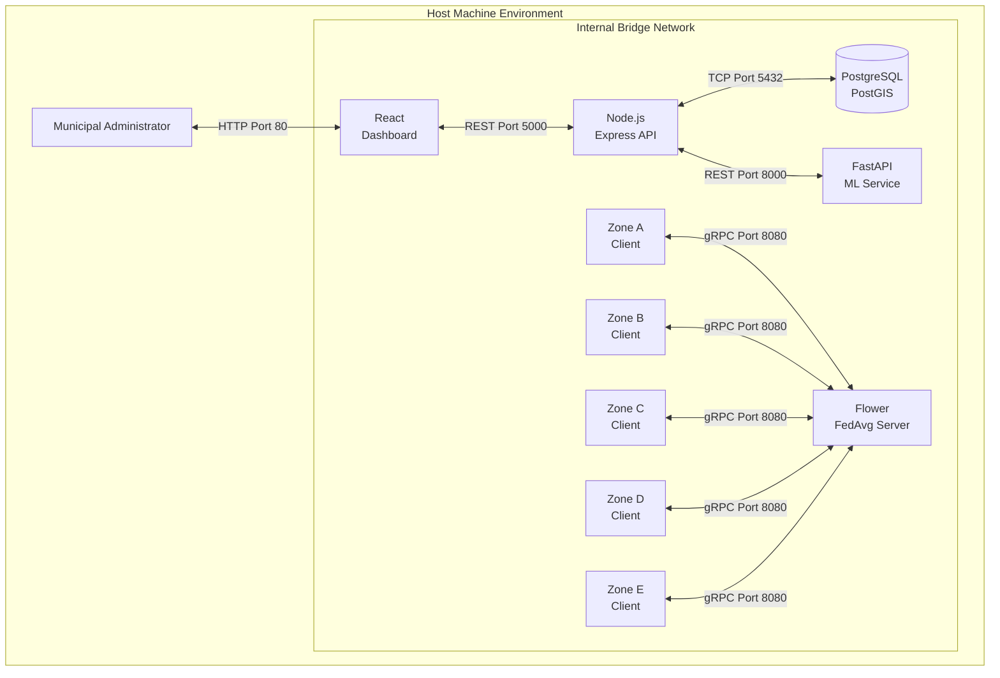

# CHAPTER 8: DEPLOYMENT AND USER DOCUMENTATION

## 8.1 Deployment Architecture
SAMVED HealthGrid employs a modern, containerized deployment architecture managed entirely by Docker Compose. This ensures that the complex interdependencies between Python machine learning frameworks, Node.js asynchronous APIs, and PostgreSQL spatial databases are abstracted away from the end-user. Each logical entity—the five geographic Zone Clients, the Flower Server, the FastAPI Inference Service, the Node.js API, and the PostGIS database—executes within its own isolated, reproducible Docker container, communicating over an internal Docker network bridge.

*(Figure 8.1: Docker Deployment Architecture)*

## 8.2 Installation and Setup Procedure
The following steps detail the procedure to deploy the simulation-based proof of concept from source.

1. **Prerequisites**: Ensure Docker Desktop and Docker Compose are installed and running on the host machine.
2. **Clone Repository**: Execute `git clone <repository_url>` and navigate into the root directory.
3. **Environment Configuration**: Copy `.env.example` to `.env` and verify database credentials and API ports (Default 5432, 5000, 8000).
4. **Dataset Generation**: Run the synthetic generator (if not using pre-generated data) to populate the `data/synthetic_zones` folder with the multi-source SEIRS CSV files.
5. **Docker Build**: Execute `docker-compose up --build -d` to compile the React application, pull the PostGIS images, and install all Python pip requirements.
6. **Service Startup**: Docker will automatically start the Flower server, which will wait for all 5 Zone Clients to connect.
7. **Federated Training**: The Zone Clients will automatically execute local PyTorch training and push parameter updates to the Flower server for 10 rounds. Upon completion, the server saves `global_model_final.pth`.
8. **Database Initialization**: The PostGIS container executes `init.sql` upon first startup to generate the spatial `predictions` table.
9. **Inference Trigger**: Trigger the integration test by executing a POST request to the API: `curl -X POST http://localhost:5000/api/ai/trigger-pipeline`.
10. **Dashboard Access**: Open a web browser and navigate to `http://localhost:80` to access the React Leaflet dashboard.
11. **Log Inspection**: Run `docker-compose logs -f` to monitor the microservice communication in real-time.
12. **Shutdown**: Execute `docker-compose down -v` to tear down the containers and delete the database volumes.

## 8.3 README Structure
The project repository contains a comprehensive standard `README.md` structured as follows:
- **Project Title and Badges**
- **System Overview & Privacy Architecture**
- **Repository Structure Map**
- **Prerequisites (Docker, Node, Python)**
- **Quickstart Guide (docker-compose up)**
- **Evaluation Guide (How to run the phase4_final.py script)**
- **API Documentation (cURL examples for /predict)**
- **Troubleshooting & Common Docker Errors**

## 8.4 User Manual
The primary interface for municipal administrators is the React-based GIS Dashboard.

1. **Dashboard Navigation**: Upon opening the application, the user is presented with a full-screen Leaflet map displaying the geographic boundaries of Zones A through E.
2. **Zone Selection**: Clicking on any specific zone polygon opens a detailed sidebar containing that zone's specific syndromic indicators (e.g., current pharmacy demand, hospital admissions).
3. **Date Filters**: The top navigation bar provides a slider allowing the user to filter historical risk predictions and view daily or weekly trends.
4. **GIS Heatmap**: The core visual indicator. Polygons are dynamically colored based on the latest AI inference output:
   - **Green (Low Risk)**: Probability < 0.3
   - **Yellow (Medium Risk)**: Probability 0.3 - 0.5
   - **Red (High Risk)**: Probability > 0.5
5. **Alerts**: When a zone enters the Red "High Risk" state, a notification banner explicitly warns the administrator that the underlying Federated Learning model has predicted a latent outbreak onset within the upcoming 7 days.
6. **Error States**: If the backend API is disconnected, the map defaults to grey boundaries and displays an "API Offline" indicator to prevent the display of stale data.

[INSERT ACTUAL SCREENSHOT: Full-screen React dashboard showing a Red "High Risk" alert over Zone B, with the detailed syndromic data sidebar open.]

### 8.4.1 Project Demonstration Script
*(For a 5-8 minute viva presentation)*
- **Minute 1**: Open the presentation by explaining the privacy dilemma of centralized health data and how FedAvg solves it.
- **Minute 2**: Show the `docker-compose up` terminal logs. Highlight the Flower server executing FedAvg rounds and aggregating weights from 5 clients in real-time.
- **Minute 3**: Point to the `global_model_final.pth` file generation, proving training success.
- **Minute 4**: Open the React GIS dashboard. Explain that it is completely decoupled from the training data.
- **Minute 5**: Trigger an API inference payload via Postman. Watch the Leaflet map update from Green to Red in real-time.
- **Minute 6**: Present the CSV evaluation metrics (PR-AUC) explaining the mathematical trade-off between detecting the outbreak early and the resulting False Warning Rate.

### Chapter Summary
This chapter provided the precise, container-based deployment procedures required to replicate the proof of concept. The Docker architecture enforces microservice isolation while maintaining seamless communication. The user manual and demonstration script solidify how the complex backend federated mechanics are simplified into an intuitive, color-coded GIS alerting system for municipal administrators.
