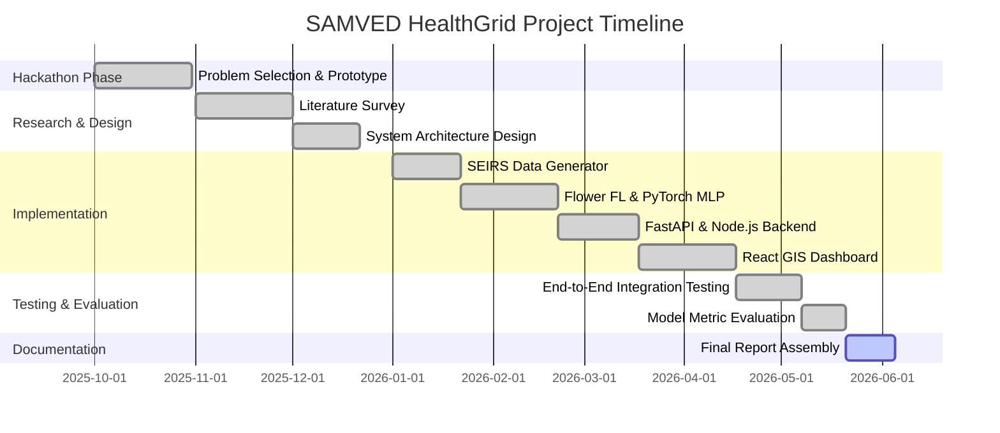

# ACHIEVEMENTS AND ACTIVITY CHART

## List of Publications, IPR and Achievements

Table: List of Publications, IPR and Achievements
| Sr. No. | Type | Title/Description | Inventors/Team | Authority | Status |
| :--- | :--- | :--- | :--- | :--- | :--- |
| **1** | Competition | Smart Public Health System | Abhijeet, Shubham, Aditya, Abhishek | SMC Hackathon 2025-26 | Participated (Prototype Round) |
| **2** | Research Paper | Privacy-Preserving Disease Surveillance | Abhijeet, Shubham, Aditya, Abhishek | TBD | Pending Draft |

*(Note: Plagiarism Report to be physically appended after generation using the institute-approved tool)*

## Project Activity Chart

