# MERMAID DIAGRAMS MASTER LIST
*(Note: These diagrams are also embedded within their respective chapters. They are compiled here for easy rendering/copying.)*

## Chapter 2 Diagrams

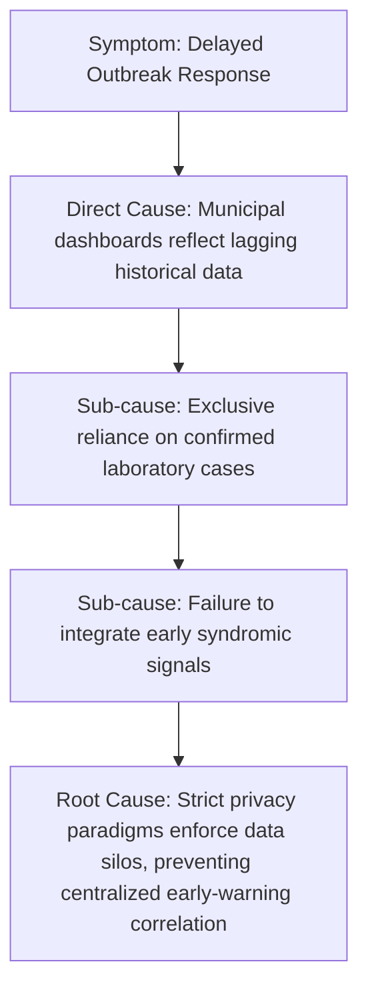

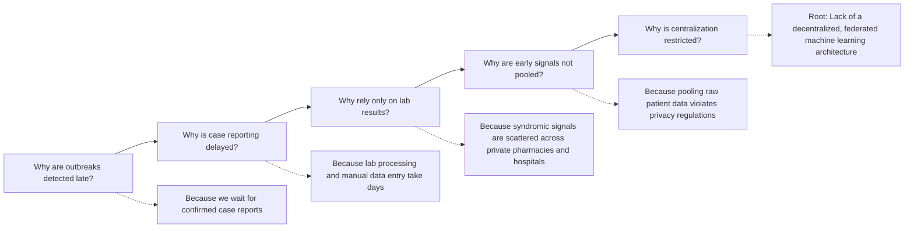

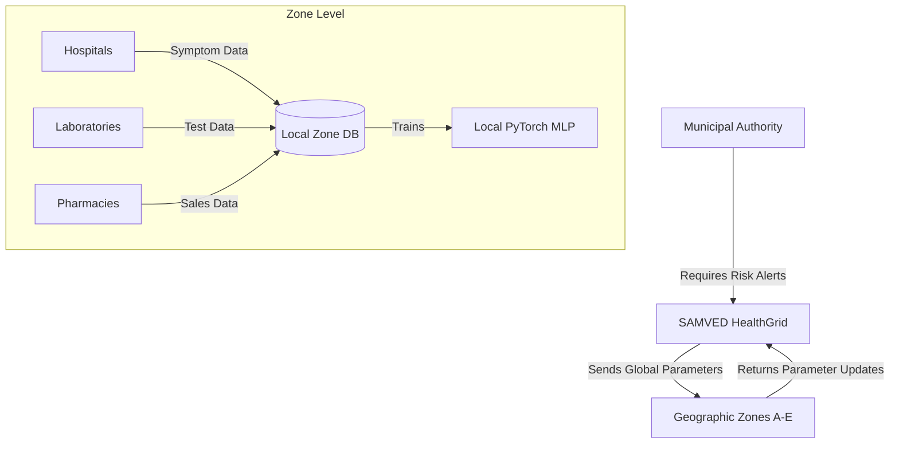

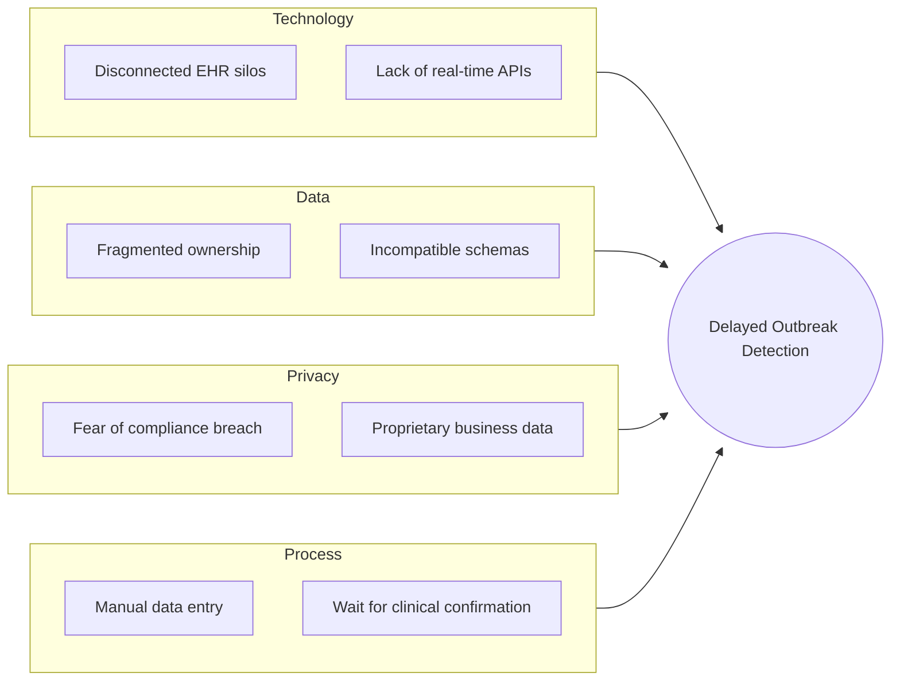

## Chapter 5 Diagrams

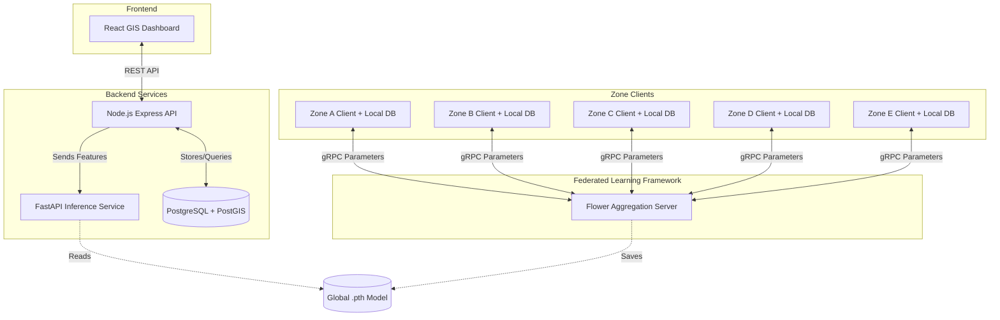

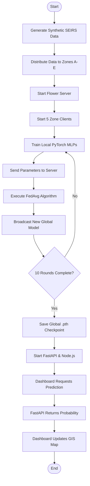

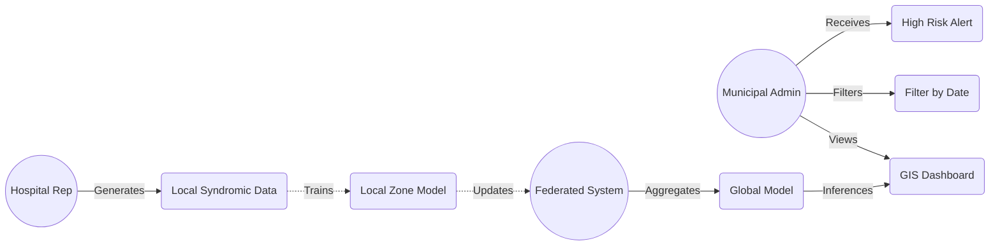

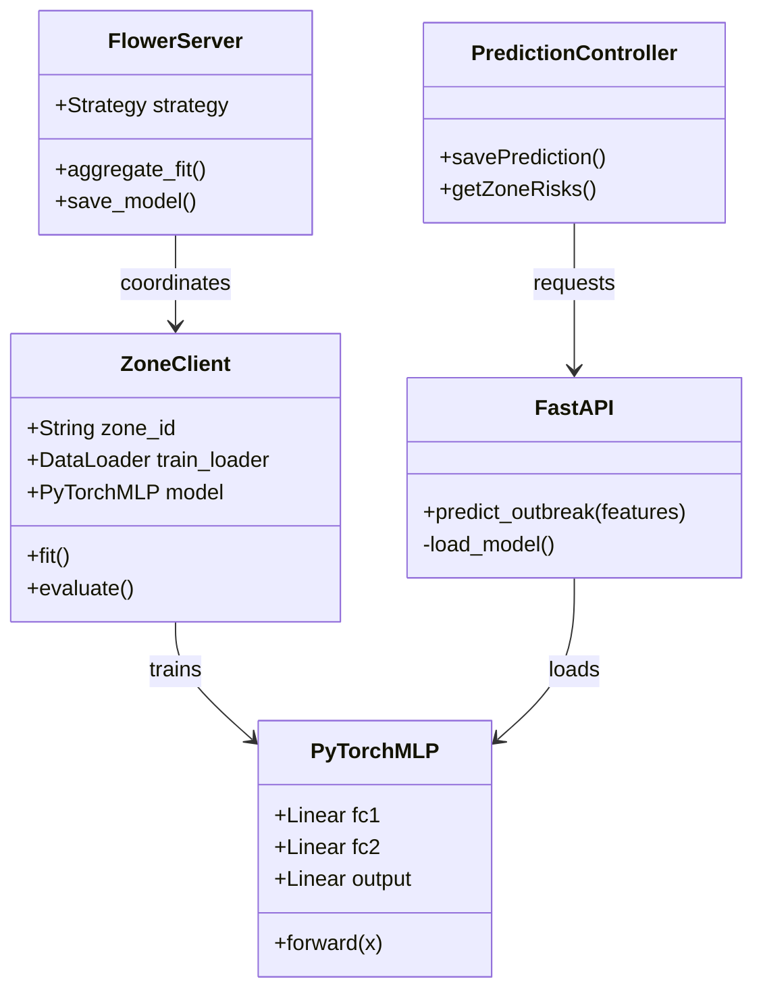

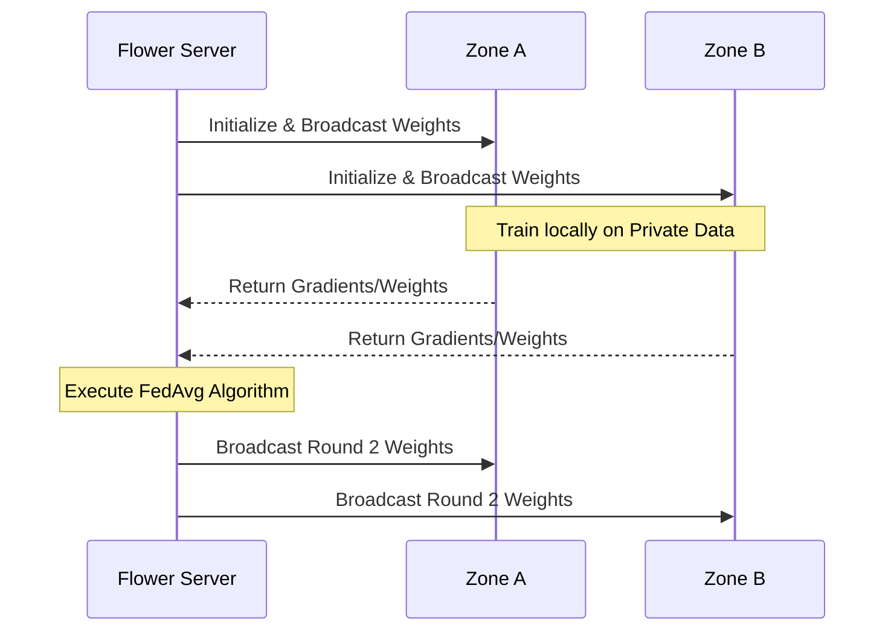

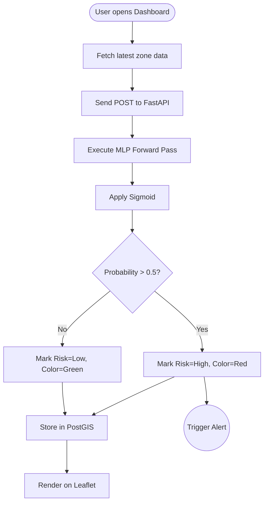

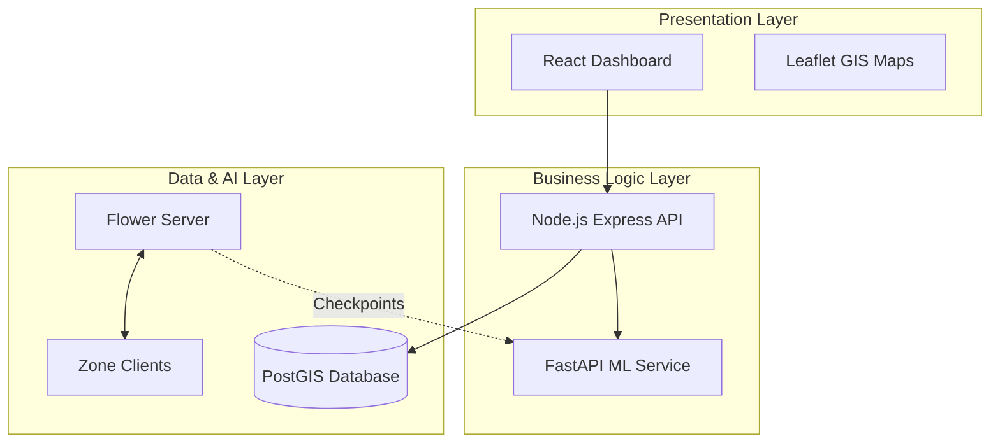

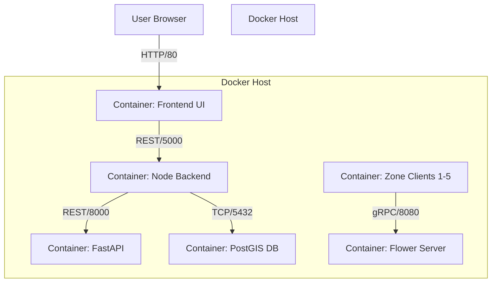

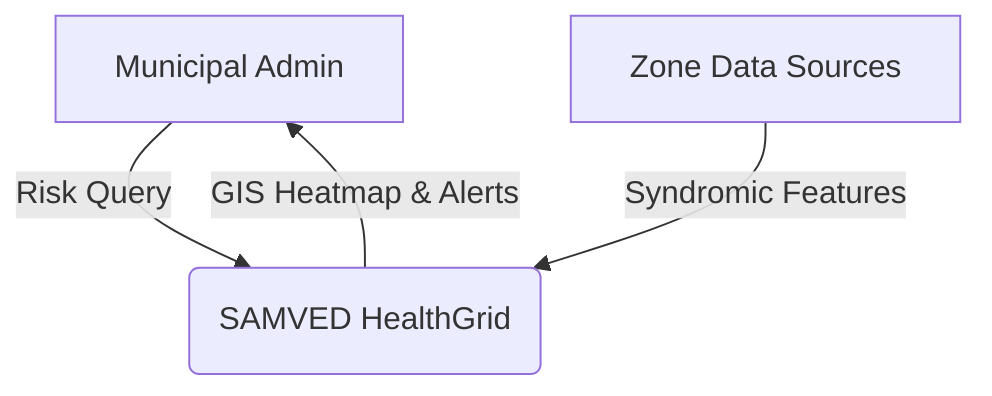

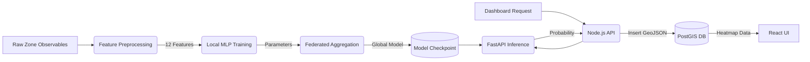

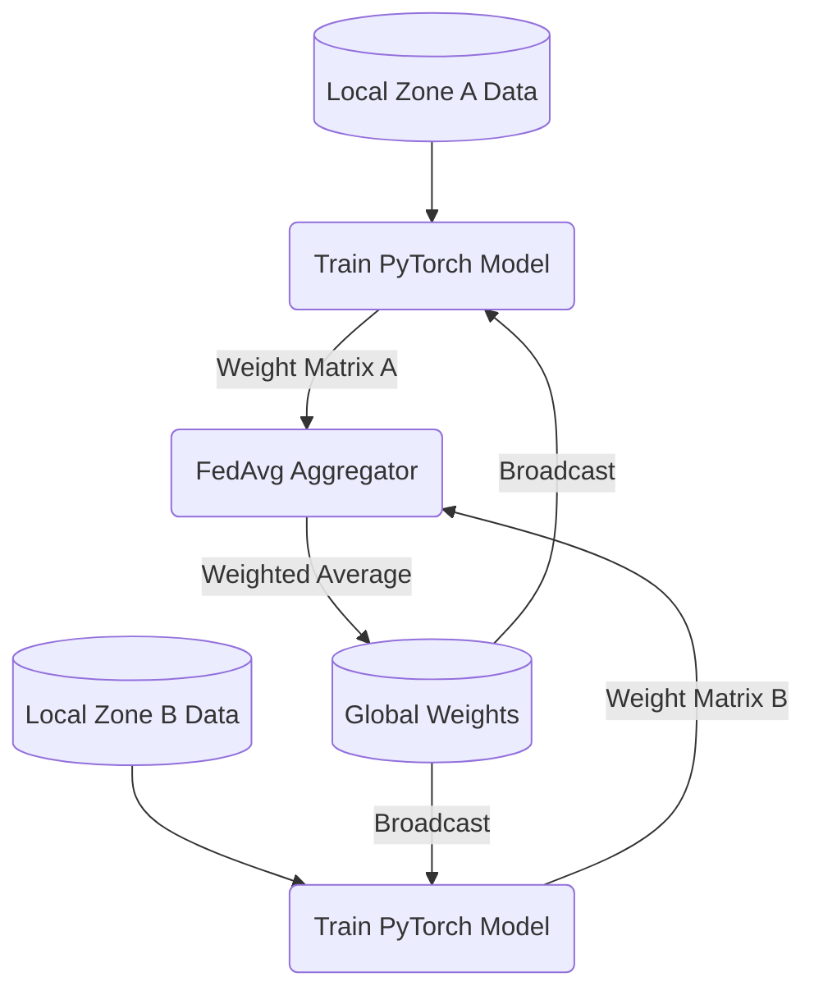

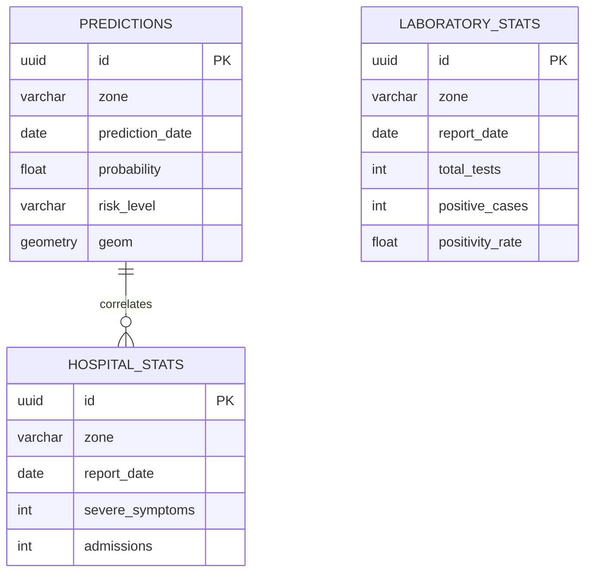

## Chapter 6 Diagrams

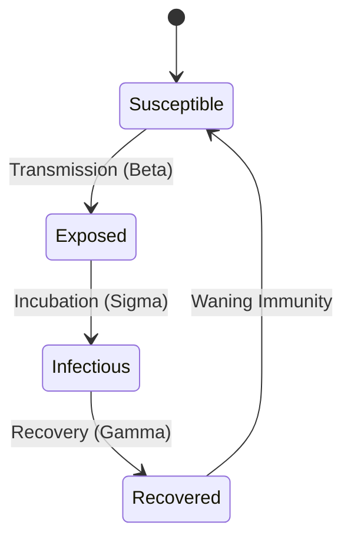

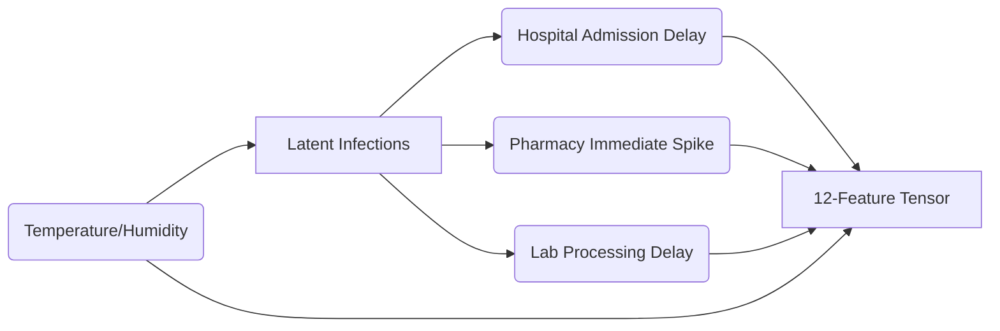

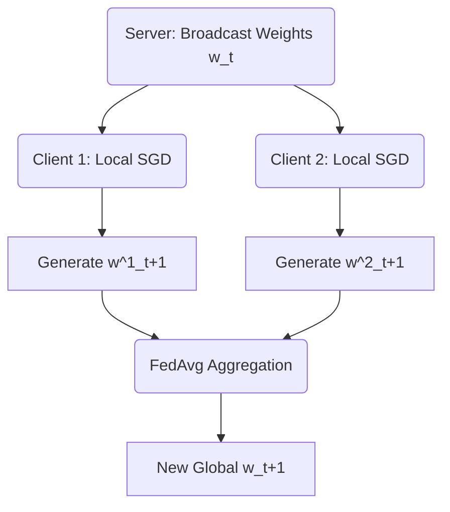

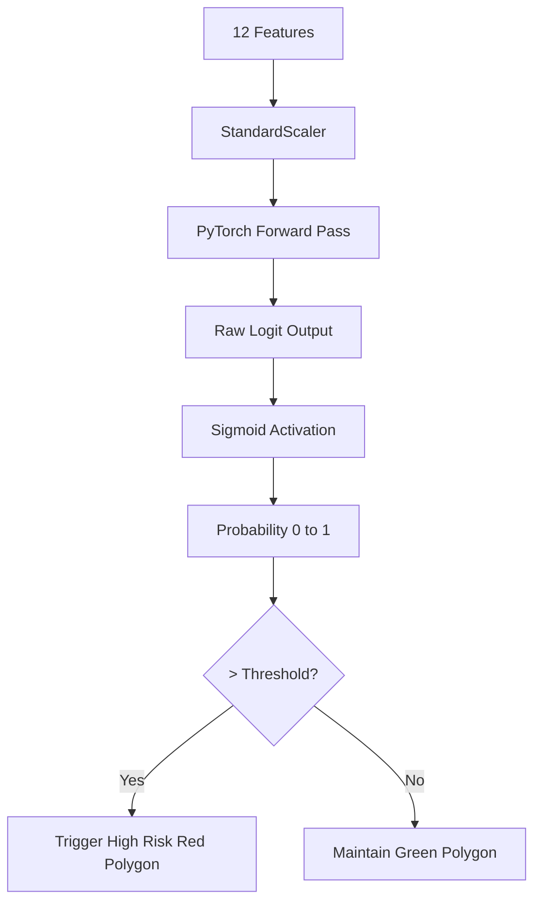

## Chapter 8 Diagrams

```mermaid
%% Figure 8.1: Docker Deployment Architecture
flowchart TD
    subgraph Host Machine Environment
        subgraph Docker Network [Internal Bridge Network]
            DB[(PostgreSQL\nPostGIS)]
            Node[Node.js\nExpress API]
            FastAPI[FastAPI\nML Service]
            Flower[Flower\nFedAvg Server]
            Z1[Zone A\nClient]
            Z2[Zone B\nClient]
            Z3[Zone C\nClient]
            Z4[Zone D\nClient]
            Z5[Zone E\nClient]
            React[React\nDashboard]
        end
        
        Admin[Municipal Administrator]
        Admin <-->|HTTP Port 80| React
        React <-->|REST Port 5000| Node
        Node <-->|REST Port 8000| FastAPI
        Node <-->|TCP Port 5432| DB
        
        Z1 <-->|gRPC Port 8080| Flower
        Z2 <-->|gRPC Port 8080| Flower
        Z3 <-->|gRPC Port 8080| Flower
        Z4 <-->|gRPC Port 8080| Flower
        Z5 <-->|gRPC Port 8080| Flower
    end
```
